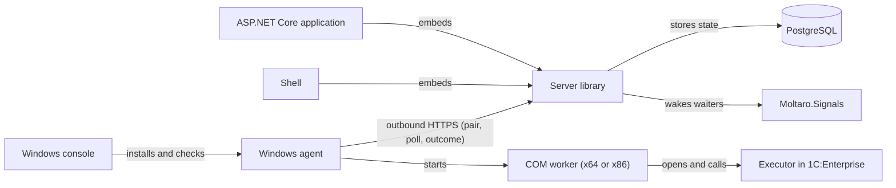

# How the library is built

An ASP.NET Core application embeds the server and calls it to manage agents and send
a Read or Write. The shell embeds the same library for a session by hand. In the back
office, the console installs, pairs and checks the Windows agent.

The server keeps agents, commands and outcomes in PostgreSQL. Moltaro.Signals wakes
waiting polls and calls so each node can read the store. The application supplies
both services. The agent opens every network request to the server.

Only the COM worker calls the 1C COM connector. A worker holds a session for one
base and mode. It opens a fresh copy of the executor in that session for each
command. The executor runs the script inside 1C and returns the outcome as JSON.

## Project dependencies

| Project | Depends on |
| --- | --- |
| Server | Protocol, ASP.NET Core, EF Core with Npgsql, Moltaro.Signals |
| Agent | Protocol |
| Console | Agent, Protocol, Spectre.Console, Spectre.Console.Cli |
| Shell | Server, Spectre.Console, Spectre.Console.Cli |
| Protocol and COM worker | .NET |

The server is the single NuGet package and includes the matching protocol assembly.
The Windows archive contains the agent, console, both builds of the COM worker
and the executor. The shell runs from the repository.

See [The path of a command](command-path.md) for how a Read or Write travels through
these parts. Open the [standalone figure](library-architecture.html) to view this page
from disk.
